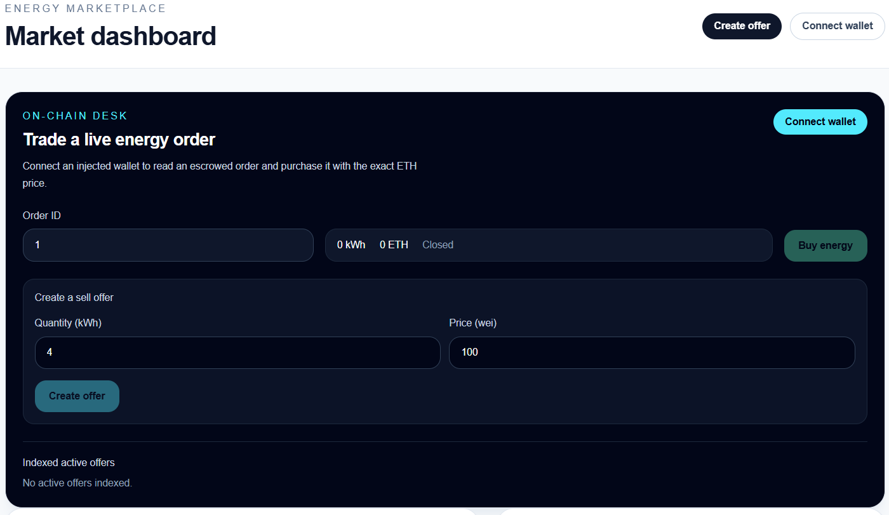
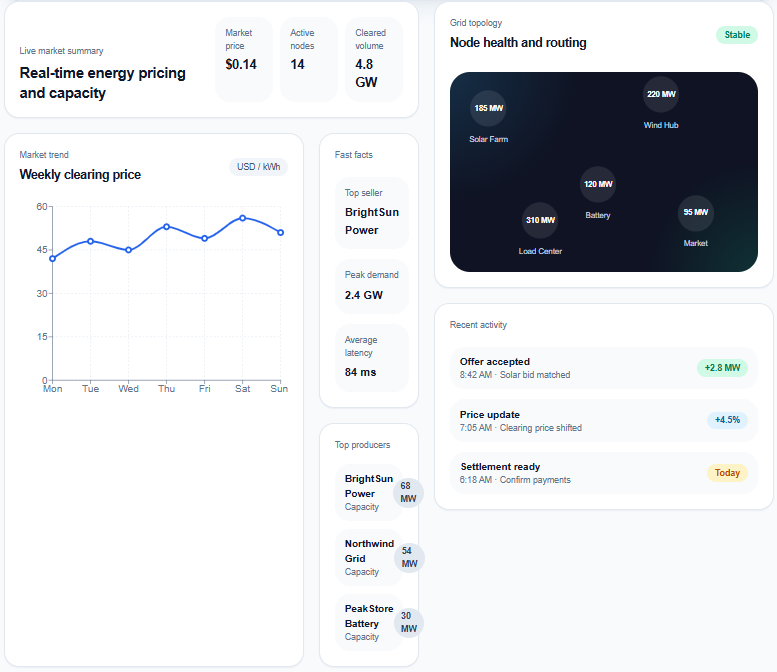

# Decentralized Energy Marketplace

A local-first peer-to-peer energy trading application. Energy is represented by
an ERC-20 token, while the marketplace uses full-fill escrow and native ETH for
settlement.

## Current Implementation

The project currently includes a working end-to-end local marketplace slice:

- `EnergyToken.sol`: owner-controlled ERC-20 token with whole-kWh units. One
	token represents one kWh; minting and burning are owner-only.
- `Marketplace.sol`: creates sell orders, escrows energy, accepts exact-ETH
	purchases, and supports seller cancellation with escrow refunds.
- NestJS backend: indexes `SellOrderCreated`, `EnergyPurchased`, and
	`SellOrderCancelled` events into SQLite and exposes active offers through
	`GET /v1/marketplace/offers` and the trade history through
	`GET /v1/marketplace/history` (optionally `?account=0x...` for one wallet).
- Next.js frontend: connects a wallet, shows its ENRG balance, reads orders,
	creates offers through `approve` followed by `createSellOrder`, buys active
	orders, lets sellers cancel their own offers, lists the transaction history,
	and displays transaction progress and errors.
- Energy simulation: the backend simulates six households every 10 seconds,
	moving a simulated clock 15 minutes per update. Solar output follows the time
	of day and the weather (sunny adds 30%, cloudy and rainy cut it), and demand
	has morning and evening peaks. Surplus builds up as stored energy, and a
	deficit is drawn from the grid. `GET /v1/simulation/state` and
	`GET /v1/simulation/history` expose it, and the dashboard shows it live.
	"Your home" belongs to the local wallet, and
	`POST /v1/simulation/households/home/claim` mints its whole kWh of surplus as
	ENRG, ready to sell. `SIMULATION_TICK_MS` and `SIMULATION_MINUTES_PER_TICK`
	change the pace.
- Dynamic pricing: every simulation update sets the market price with the
	rule `price = base + k × (demand - supply)`, clamped between a fifth and
	five times the base. The defaults are 0.0001 ETH per kWh and 0.000003 ETH
	per kW of imbalance; `PRICING_BASE_WEI_PER_KWH` and `PRICING_K_WEI_PER_KW`
	override them. The price is part of `GET /v1/simulation/state`, each
	`/v1/simulation/history` entry and every `simulation.tick` event. The
	dashboard shows it live, charts it over the simulated day, and the offer
	form suggests a total price at the market rate.
- Real-time updates: the backend pushes events over a WebSocket at
	`ws://<backend>/v1/realtime`. `simulation.tick` carries the full simulation
	state on every update, and `market.activity` carries each new listing,
	purchase or cancellation as soon as it is indexed. The dashboard shows a
	"Live" badge while connected, reconnects with backoff, and falls back to
	polling the REST endpoints while the socket is down. Connections from origins
	other than `FRONTEND_ORIGIN` are refused.
- Local development bootstrap: starts Hardhat, deploys the contracts, seeds the
	local wallet with test ETH and energy, generates ignored environment files,
	and starts the backend and frontend.

The validated local lifecycle is:

```text
connect wallet -> approve ENRG -> create offer -> index active offer
-> buy energy -> index offer as inactive
```

## Home Page Screenshot

<br>


## Technology

- Smart contracts: Solidity 0.8.28, Hardhat 3, OpenZeppelin, Ethers.js
- Backend: NestJS, TypeORM, SQLite, Ethers.js
- Frontend: Next.js, TypeScript, Wagmi, Viem, Tailwind CSS, Recharts

## Run Locally

`npm run dev` installs dependencies in `smart-contracts`, `backend`, and
`frontend` whenever they are missing or no longer match `package-lock.json`
(for example after pulling a change that adds a package), so there is no
separate install step.

Copy the root environment template and fill in local values when needed:

```shell
cp .env.example .env
```

Then start the complete stack from the repository root:

```shell
npm run dev
```

The bootstrap starts or reuses the local Hardhat RPC, deploys contracts when
the deployment is missing or stale, seeds the configured local wallet, and
starts the backend and frontend. Open <http://localhost:3000> after startup.

The default local network is:

```text
Network: Localhost
RPC URL: http://127.0.0.1:8545
Chain ID: 31337
Currency: ETH
```

By default, local frontend development uses Wagmi's mock connector, so a
browser wallet extension is not required. The configured local wallet address
is stored in the ignored root `.env` file. The seed script gives it test ETH
for gas and 100 ENRG for offer creation.

Press `Ctrl+C` to stop the stack. If a local Hardhat node is still healthy and
already deployed with a funded wallet, the next `npm run dev` reuses it instead
of redeploying, so local offers persist across restarts of the backend and
frontend. If anything is left running in the background (for example after a
crash), run `npm run dev:stop` to stop all local stack processes.

## Useful Commands

Run the contract tests:

```shell
cd smart-contracts
npx hardhat test test/EnergyToken.ts test/Marketplace.ts
```

Build and lint the frontend:

```shell
cd frontend
npm run lint
npm run build
```

Build the backend:

```shell
cd backend
npm run build
```

To update semver:

```shell
npm run release
```

## Current Limitations

- Orders are full-fill only; partial fills, edits, expiry, fees, and stablecoin
	payments are not implemented.
- The backend settlement endpoint uses a configured backend signer as an
	operator buyer. It is a demo flow, not wallet-authenticated production
	settlement.
- Offers are event-indexed in SQLite. On a `market.activity` event the
	frontend re-reads offers and history over REST rather than patching them
	from the event payload.
- The surplus claim endpoint is unauthenticated and mints with the token owner
	key. It is a local demo flow only.
- Local development accounts and private keys are test-only and must never be
	used on a live network.

Planned follow-up work is indexer restart/reorg handling, settlement API
hardening and persistence, and broader integration coverage.

## Future Scope

Grid governance, role-based token authority, multisig ownership, emergency
recovery, and AI-driven optimization remain future extensions.